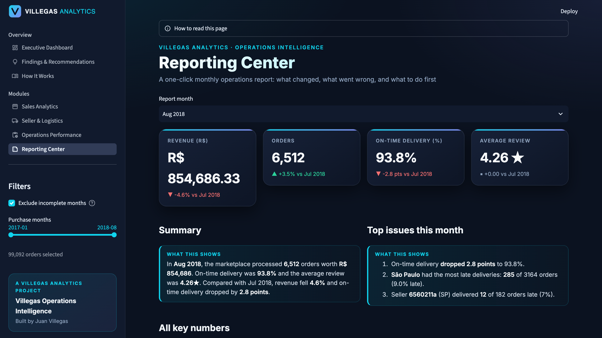
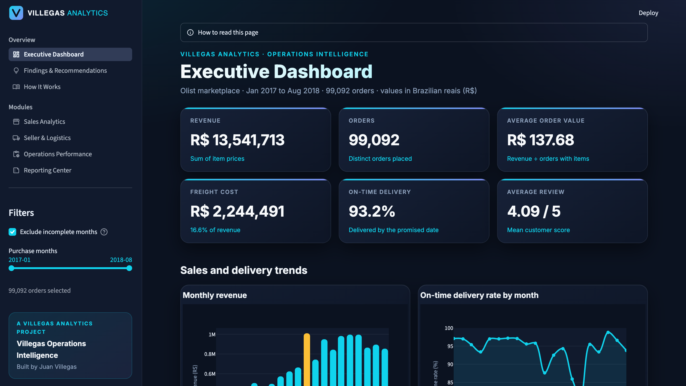
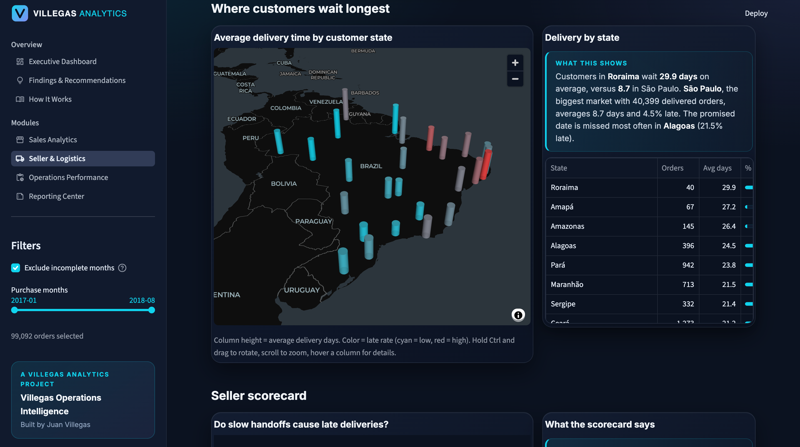
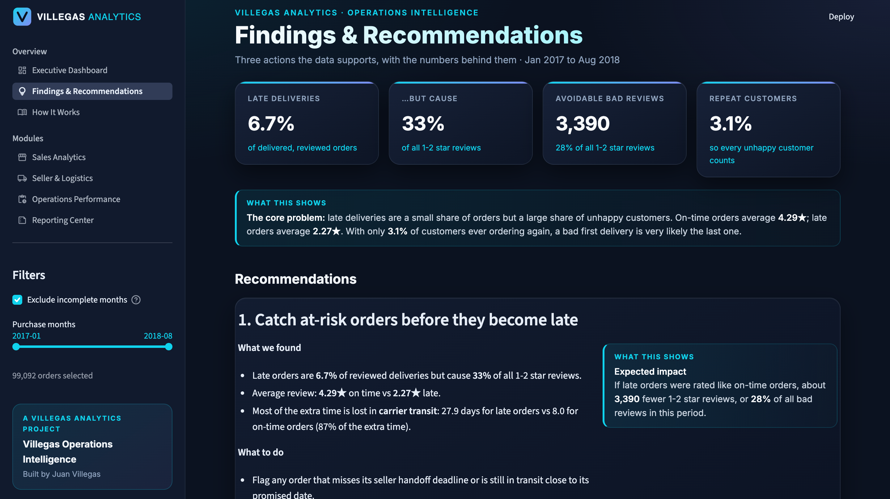
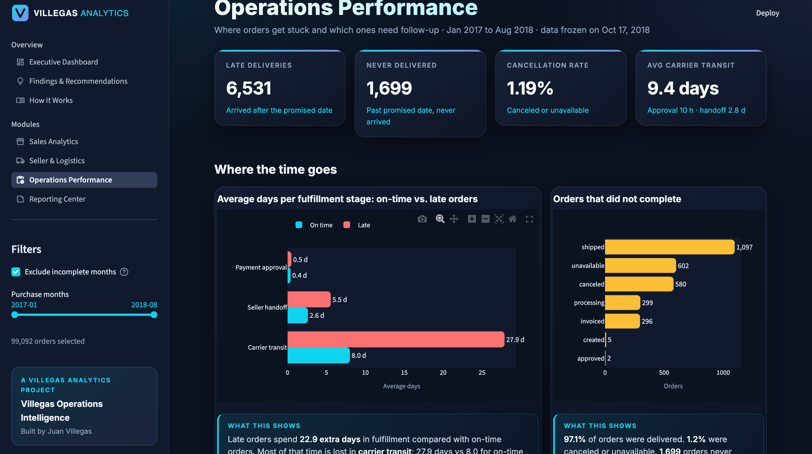
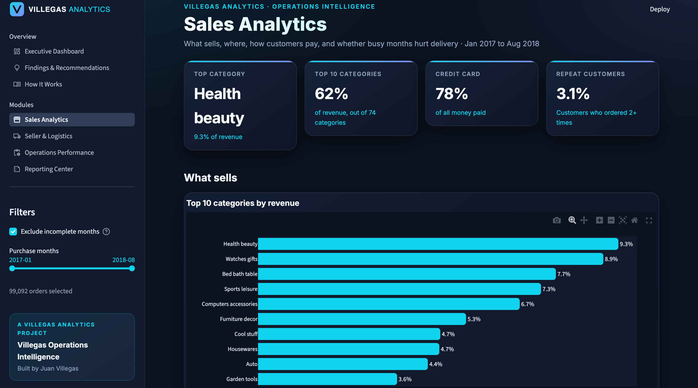

# Villegas Operations Intelligence

**Operations analytics app built on ~100,000 real e-commerce orders.**
It answers one business question: *late deliveries are hurting customer satisfaction. Where, why, and what should we fix first?*

Built by **Juan Villegas** · Villegas Analytics
Python · SQL · SQLite · Pandas · Streamlit · Plotly · pydeck · pytest

---

## Screenshots

**Executive Dashboard:** headline KPIs, trends, and late delivery vs. review score


**Findings & Recommendations:** three data-backed actions with live impact estimates


**Seller & Logistics:** 3D map of delivery time by state, plus the seller scorecard


**Operations Performance:** where late orders lose time, plus the late-order exception list


**Sales Analytics:** categories, states, payments, and peaks vs. delays


**Reporting Center:** a one-click monthly report with month-over-month changes


---

## Quick start (fastest way to run it)

### Already set up on this computer: one command

```bash
cd ~/Desktop/villegas-operations-intelligence
./run.sh
```

The app opens at **http://localhost:8501**. Press `Control + C` in Terminal to stop it.

### First time on a new computer: 3 steps

**1. Get the code**

```bash
git clone https://github.com/villegasjv55/villegas-operations-intelligence.git
cd villegas-operations-intelligence
```

**2. Get the data** (free Kaggle account needed)

Download the dataset from https://www.kaggle.com/datasets/olistbr/brazilian-ecommerce, then unzip the 9 CSV files into `data/raw/`:

```bash
mkdir -p data/raw
unzip ~/Downloads/archive.zip -d data/raw
```

**3. Run it**

```bash
./run.sh
```

The first run creates a virtual environment, installs the packages, and builds the database (about 1-2 minutes in total). Every run after that starts in seconds.

Requires **Python 3.11+** on macOS or Linux. On Windows, use the manual steps below.

### Manual steps (what `run.sh` does for you)

```bash
python3 -m venv .venv
source .venv/bin/activate
pip install -r requirements.txt
python src/data_loader.py      # CSV files -> SQLite database
python -m src.cleaning         # build the clean analysis tables
streamlit run app.py
```

### Run the tests

```bash
pytest
```

Every key number is calculated twice (SQL and Pandas) and checked by automated tests.

---

## What the app does

| Page | What it answers |
|---|---|
| **Executive Dashboard** | Revenue, orders, on-time rate, reviews, monthly trends, and late delivery vs. review score |
| **Findings & Recommendations** | Three data-backed actions, each with live impact estimates |
| **How It Works** | The data, every metric's definition, how numbers are verified, and the limitations |
| **Sales Analytics** | Top categories, revenue by state, payment methods, peaks vs. delays, repeat customers |
| **Seller & Logistics** | Seller scorecard, bottom-10 follow-up list, and a 3D map of delivery times by state |
| **Operations Performance** | Where time is lost (approval, handoff, transit), cancellations, and a late-order exception list with CSV export |
| **Reporting Center** | A one-click monthly report with month-over-month changes, top issues, and HTML/CSV download |

A shared month filter in the sidebar updates every page, and each chart has a plain-English summary written from the data.

## Key findings

- **Late deliveries destroy reviews.** On-time orders average **4.29 stars**; orders 4-7 days late average **2.11**, and about 2 in 3 of them get a 1-2 star review.
- **Late orders are a small share of deliveries but cause about a third of all 1-2 star reviews.**
- **93.2%** of orders arrive on time, but most promised dates are padded, while a few states (such as Alagoas) miss them far more often.
- **Slow is not the same as late:** Amapá and Amazonas wait 26-27 days but are rarely late, because their promised dates are realistic.
- Sellers who often miss their shipping deadline deliver late much more often than the rest.
- Only **3.1%** of customers ever order again, so a bad first delivery is usually the last.

## How it works

```
Raw CSVs  ->  SQLite database  ->  quality checks & clean tables  ->  metrics (SQL + Pandas)  ->  Streamlit app
```

- **Load:** the 9 Olist CSV files are loaded into one SQLite database.
- **Check:** 16 data-quality checks run before any metric (missing dates, impossible dates, duplicates).
- **Clean:** items, payments and reviews are summarized per order *before* joining, so no order is double-counted.
- **Verify:** key metrics are calculated in both SQL (from raw tables) and Pandas (from clean tables), and pytest confirms they match.
- **Present:** a multi-page Streamlit app with Plotly charts and a pydeck 3D map.

## Project structure

```
app.py               entry point: menu, shared filter, branding
run.sh               one-command setup and launch
pages/               one file per page
src/
  data_loader.py     CSVs -> database
  quality_checks.py  data quality checks
  cleaning.py        clean analysis tables
  analytics.py       core KPIs (SQL and Pandas)
  sales.py, logistics.py, operations.py, reporting.py, findings.py   module logic
  insights.py        plain-English chart summaries
  explain.py         in-app explanations and definitions
  style.py           theme, cards, charts, tables
tests/               automated checks
docs/                learning log and project write-ups
```

## Limitations

- **No profit:** Olist does not publish product costs, so the app reports revenue and shipping cost, not profit.
- **No inventory data**, so stock levels cannot be analyzed.
- **Historical snapshot (2016-2018):** the numbers describe that period, not today.
- **Correlation, not proof:** the patterns are strong, but confirming causes would need data Olist did not publish, such as carrier names.
- Values are in **Brazilian reais (R$)**.

## Data and license

Data: [Olist Brazilian E-Commerce Public Dataset](https://www.kaggle.com/datasets/olistbr/brazilian-ecommerce) (Kaggle), licensed **CC BY-NC-SA 4.0**. Used here for a non-commercial portfolio project with credit to Olist. The raw data is not included in this repository; download it from Kaggle as described above.